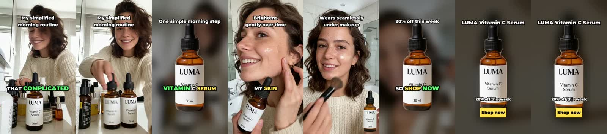
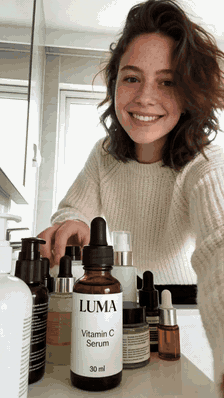
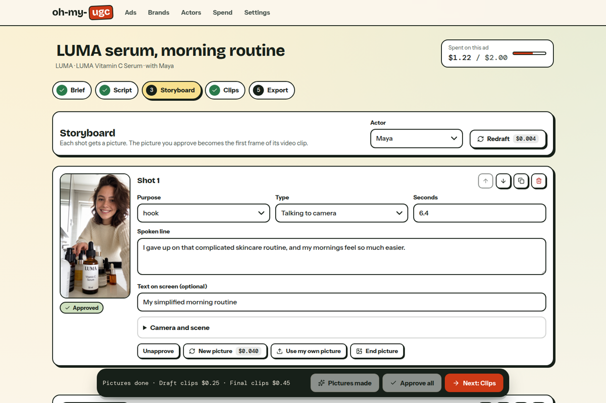
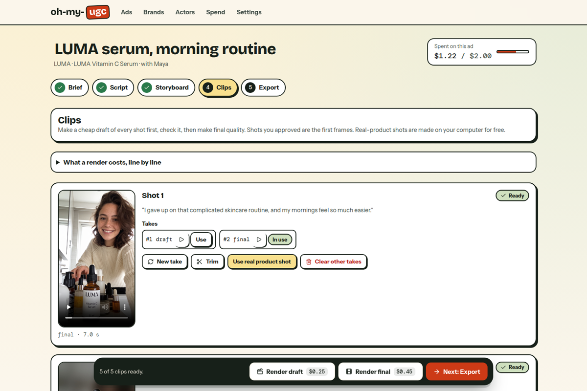
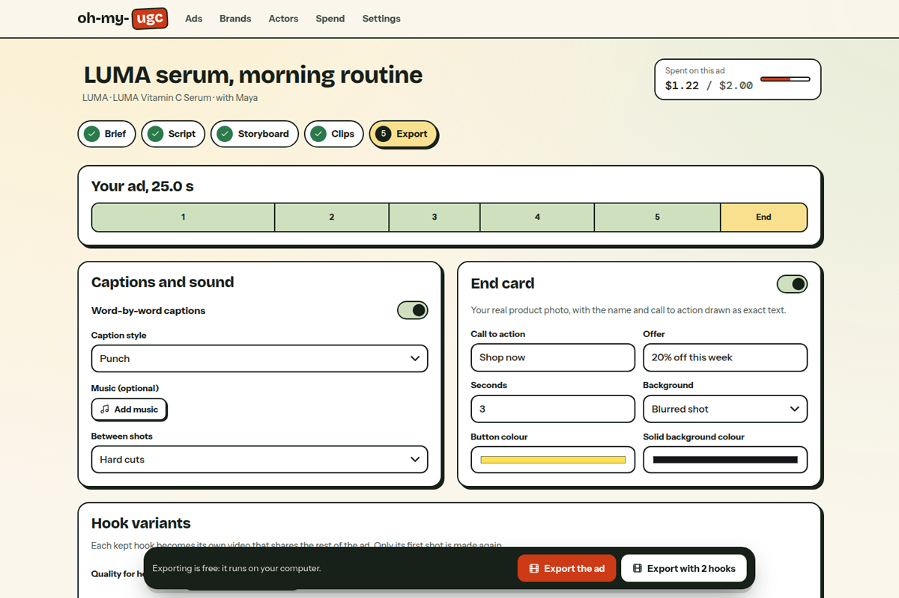
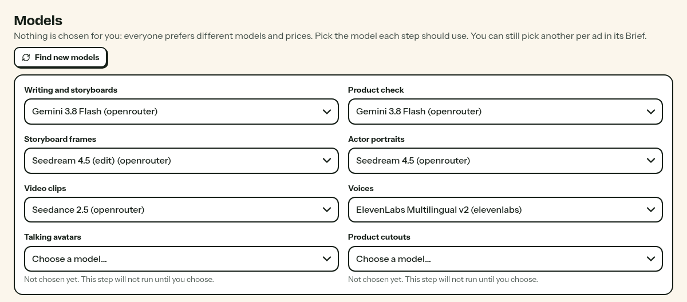
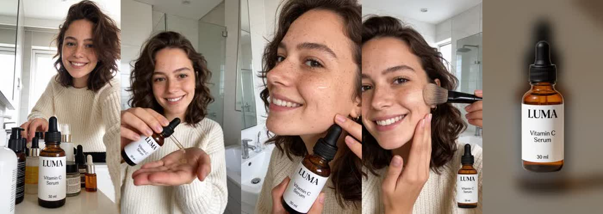

# oh-my-ugc

**UGC video ads from your own computer.** Product photos, your brand and a script go in. Out comes a vertical ad
with an AI actor, a voice, word-by-word captions and an end card. You use your own Replicate, fal or OpenRouter key,
so there are no credits, no watermark and no subscription. You pay the model's price and nothing more.

[](https://github.com/T3-Venture-Labs-Limited/ohmyugc/actions/workflows/ci.yml)
[](LICENSE)




> **Every frame above is real output.** The brand, LUMA, and the actor, Maya, are made up: both were generated for the
> demo. The ad cost $1.22, including two alternative openings and four clips that were thrown away.
> [The breakdown is below.](#what-it-costs)

## Highlights

- **You pay the model, not a markup.** Bring a key for [Replicate](https://replicate.com), [fal](https://fal.ai) or
  [OpenRouter](https://openrouter.ai). Every button that spends money shows its price first, a ledger records what was
  spent, and a budget per ad stops any step that would go over it.
- **You choose every model.** Nothing is picked for you. Settings lists what your keys can run, with prices, and you
  choose the model for each step. Change it for one ad, or for all of them.
- **Your real product in every shot.** Generated pictures and clips are compared with your photo by a vision model, down
  to the exact label text. Close-ups, reveals and the end card use your original photo, so no model can misspell your
  label. [How it works](#the-product-stays-correct).
- **Approve before you spend.** A storyboard of cheap pictures comes first. The picture you approve becomes the first frame
  of its clip. Drafts render at the cheapest setting; only the shots you like are made again at full quality.
- **Test your openings.** Write several hooks and export one video per hook. The rest of the ad is shared, so each extra
  version costs only its first shot.
- **Nothing is paid for twice.** Results are cached by content, and a job that was interrupted picks up the provider's job
  where it left off.
- **Web app, command line and AI agent.** A local web app, a `--json` command line, and a skill file so Claude Code, Codex
  or Pi can make ads for you.

## Screenshots

**The finished ad.** The first 12 seconds of the demo, at 9:16:

<p align="center">
  
</p>

**Storyboard.** Each shot has a picture, a spoken line and an approve button. The bar at the bottom shows what the next
steps will cost:



**Clips.** Play every take, keep the best one, or swap a shot for one made from your real product photo:



**Export.** Captions, music, the end card, and one video per hook:



**Settings.** You choose the model for each step. A step with no model chosen does not run:



## How an ad is made

1. **Brief.** Pick a brand (voice, audience, what to mention, claims to avoid, offer), a product (real photos and the exact
   label text) and an actor (described in words, or from a photo). Choose a format, a length and a shape: 9:16, 1:1, 4:5
   or 16:9.
2. **Script.** Paste your own, or have a language model write one from your brand and product. It warns you about any
   claim you said never to make. Add alternative opening hooks to test.
3. **Storyboard.** The script is split into shots: who is on screen, what happens and which words are said. Each shot gets
   a picture with your actor and your product. Regenerate it, upload your own, set an end picture, join shots into one
   clip, add text cards, reorder, approve.
4. **Clips.** Make a cheap draft of every shot, check it, then make the good ones at full quality. A flagged clip offers a
   new take or a real-product shot in one click.
5. **Export.** Word-by-word captions in 15 styles (from [popcaps](https://github.com/T3-Venture-Labs-Limited/popcaps)),
   on-screen text, music that drops under speech, an end card and loudness set for social platforms. Export one video, or
   one per hook.

## Install

| You need | Why |
|---|---|
| Python 3.11 or 3.12 and [uv](https://docs.astral.sh/uv/) | runs the app |
| Node 22 or newer | builds the web app once |
| FFmpeg with libass | cuts the video and draws captions and text |
| A key for Replicate, fal or OpenRouter | makes the pictures and clips; voices need ElevenLabs or Fish Audio, or a model on fal or Replicate |

> **Instructions for an AI agent.** Run these steps in order and stop at the first failure.
>
> 1. Install with the commands in "Run it" below.
> 2. Check: `uv run omu doctor` must show `ok` for FFmpeg, Text and captions, and Data folder.
> 3. Keys: never ask the user to paste a key into the chat. They paste it in Settings, or set it as an environment
>    variable before starting the app (`OPENROUTER_API_KEY`, `REPLICATE_API_TOKEN`, `FAL_KEY`, `ELEVENLABS_API_KEY`,
>    `FISH_API_KEY`).
> 4. Models: never choose one for the user. Show `uv run omu models list --connected` with its prices and let them pick.
> 5. Spending: run paid steps with `--estimate` first, show the cost, and wait for the user's go-ahead.
>
> [`skills/oh-my-ugc/SKILL.md`](skills/oh-my-ugc/SKILL.md) has the whole workflow.

### Run it

```bash
git clone https://github.com/T3-Venture-Labs-Limited/ohmyugc.git
cd ohmyugc
uv sync
npm --prefix frontend ci && npm --prefix frontend run build
uv run omu          # opens http://127.0.0.1:8000
```

The first screen is Settings. Paste a key, choose a model for each step you want to use, and make your first ad.
`omu doctor` checks FFmpeg, your data folder, your keys and which steps still need a model.

### Docker

```bash
docker compose up --build        # http://127.0.0.1:8000, data in ./data
```

### macOS and Windows

- **macOS:** Homebrew's standard `ffmpeg` is built without libass, which draws captions and text. Run
  `brew install ffmpeg-full`; oh-my-ugc finds it even though it is not on your `PATH`.
- **Windows:** use Docker or WSL. Native Windows is not tested.

## Keys and models

| Key | What it can run |
|---|---|
| **OpenRouter** | writing, storyboards, the product check, pictures (Seedream, Nano Banana) and video (Seedance, Veo, Wan) |
| **Replicate** | pictures, video, talking avatars, lip sync, product cutouts and one voice model |
| **fal** | the same kinds of model, with a different choice and different prices |
| **ElevenLabs** or **Fish Audio** | voices for voiceover and talking avatars (Fish has a free model) |

One OpenRouter key covers everything except talking avatars, cutouts and voices. Once a key is saved, choose a model for
each step in **Settings > Models**. A step with no model chosen stays off and says what is missing. To use a different
model for one ad, choose it on that ad's Brief.

```bash
omu models list --connected                                  # what your keys can run, with prices
omu models default --task image_to_video openrouter/seedance-2.5
```

Models come from a curated catalog plus live discovery (Settings, "Find new models"). When a provider retires a model,
oh-my-ugc hides it from the pickers: it checks the providers' public pages when it starts (at most once a day) and when
you press "Find new models". Adding a model is one
[JSON file](CONTRIBUTING.md#add-a-model).

### Three ways to give an ad a voice

| Mode | What happens | Good for |
|---|---|---|
| **Voiceover** (default) | A voice you pick (ElevenLabs or Fish Audio) speaks each line over a silent clip. The same voice in every shot. | consistency, and the cheapest video |
| **The video model speaks** | Seedance, Kling or Veo say the line themselves, in sync. Seedance 2.5 takes a voice sample, so the voice stays the same. | natural lip sync in one step |
| **Talking avatar** | A voice speaks the line and an avatar model (OmniHuman) animates the picture, or a lip-sync model is added to a silent clip. | longer talking shots |

## What it costs

You see the price before you press a button, and again line by line before a render. The demo ad, from the app's own
ledger:

| Step | Calls | Cost |
|---|---|---|
| Script, hooks and storyboard (Gemini 3.8 Flash) | 3 | $0.02 |
| Storyboard pictures (Seedream 4.5, $0.04 each) | 5 | $0.20 |
| Product checks (28 pictures and clip frames) | 28 | $0.10 |
| Voice (ElevenLabs, seven lines) | 7 | $0.05 |
| Video clips (Seedance 1.5 Pro: drafts at 480p, finals at 720p, no audio) | 10 | $0.85 |
| **Total for a 25 s ad plus two hook variants** | 53 | **$1.22** |

Four of the ten clips were thrown away and made again after the product check flagged them (a label out of frame, a
dropper growing out of the bottom of the bottle). That is most of the clip cost.

Seedance 1.5 Pro has since been retired by its providers, and the video models available now cost more:

| Model | Price |
|---|---|
| Seedance 2.5 | $0.10 a second at 480p, $0.23 at 720p |
| Kling 2.6 | $0.07 a second silent, $0.14 with audio |
| Seedream 4.5 | $0.04 a picture |

Thirty seconds of Seedance 2.5 at 720p is about $7. Prices change, so trust the estimate on the button. OpenRouter's
billed amounts are recorded exactly. Replicate and fal do not report what they billed, so those calls are priced from the
model's published rates.

## The product stays correct

Video models are good at people and bad at small print. In our tests, label text turned to nonsense in motion: "Vitamin C
Serum" became "Vrumwodt Goobts". So oh-my-ugc does not trust a model with the label:

- **Real-product shots** use your original photo, cut out, with a slow push-in, pan, parallax or turn. No model touches
  those pixels, and they cost nothing.
- **The end card** is your cutout with the product name, offer and button drawn as real text, so the letters are always
  right.
- **Every generated picture and clip is checked** against your photo. A wrong shape, a wrong colour, a missing product or a
  label that differs by one letter is flagged with the exact complaint and three choices: a new take, a real-product
  shot, or keep it anyway.
- **Text is never generated.** Captions, on-screen text and text cards are drawn with libass.



The check is a second opinion, not a guarantee. It can miss things, and it can be fussy (it flagged a dropper bottle's
pipette more than once), so watch your clips.

## Command line and AI agents

Every command takes `--json`, prints one JSON document, and exits with an error document on failure. Paid steps take
`--estimate`, which spends nothing; long steps take `--wait`.

```bash
omu brands create --name "Acme" --cta "Shop now" --json
omu products add --brand $BRAND --name "Serum" --photo front.jpg --label "ACME Serum 30 ml" --wait --json
omu projects create --name "Serum ad" --brand-id $BRAND --product-id $PRODUCT --actor-id $ACTOR --json
omu script set $PROJECT --file script.txt --json
omu storyboard draft $PROJECT --wait --json
omu storyboard frames $PROJECT --estimate --json     # what it will cost; spends nothing
omu storyboard frames $PROJECT --wait --json
omu storyboard approve $PROJECT --json
omu render $PROJECT --quality draft --wait --json
omu assemble $PROJECT --all --wait --json            # the ad and every hook variant
```

[`skills/oh-my-ugc/SKILL.md`](skills/oh-my-ugc/SKILL.md) teaches an AI agent the whole workflow, including showing you
costs and waiting for your go-ahead. [`llms.txt`](llms.txt) is the short version.

## Models in the catalog

| Step | Models |
|---|---|
| Video clips | Seedance 2.5, Kling 2.6, Veo 3.1 Fast, Wan 3.0 |
| Storyboard pictures | Seedream 4.5, Nano Banana 2, 2.1 and Pro, Qwen Image Edit 2511 |
| Talking avatars and lip sync | OmniHuman, Sync Lipsync 2 |
| Voices | ElevenLabs Multilingual v2 and Flash v2.5, Fish Audio S2 Pro and the free S2.1, ElevenLabs v3 and MiniMax Speech through fal and Replicate |
| Writing and the product check | Gemini 3.8 Flash through OpenRouter |

"Find new models" adds whatever else your providers list. A discovered model is marked as such. If oh-my-ugc cannot map
its inputs, it is shown as unavailable with the reason, for example "no first-frame input".

## Your data

Everything stays in `~/.oh-my-ugc`, or in `OMU_HOME` if you set it:

- a SQLite database, readable only by you, which holds your keys;
- your photos and the generated media, each file stored once;
- finished videos and caption files, in `projects/<ad>/exports/`.

Keys are never sent back by the app's API, shown again after you save them, or written to logs. The app has no login and
answers only on your own computer: requests addressed to any other host name, and changes sent from other websites, are
refused. To reach it from another device on your network, set `OMU_ALLOWED_HOSTS` to that name and put authentication in
front of it.

## Likeness and disclosure

You can upload any face, and there is deliberately no consent check: this is software on your computer. That makes you
responsible for having the right to use someone's likeness. TikTok, Meta and YouTube require AI-generated ads to be
labelled, and some countries require disclosure too. Check the rules where you advertise.

## Remove

```bash
rm -rf ohmyugc          # the app
rm -rf ~/.oh-my-ugc     # optional: your keys, photos, ads and settings
```

With Docker, run `docker compose down` and delete the `data` folder.

## Limitations

- **Early release.** Every step was run end to end with real keys on 6 November 2026. The video model used then has since
  been retired; the models in the catalog now are covered by the test suite and a live price check
  (`tests/test_live.py`), but no full live ad has been made with them yet.
- **Tested on Linux and macOS** (CI runs Apple silicon and Intel). Native Windows is not tested.
- **Caption timing in "the video model speaks" mode** is spread over the detected speech unless you install the optional
  transcriber: `uv sync --extra transcribe`.
- **HeyGen Avatar IV** on OpenRouter is listed but unavailable until someone with the credit to test it adds a catalog
  entry.

## Contributing

Pull requests are welcome; the easiest is [a new model](CONTRIBUTING.md#add-a-model), which is one JSON file. See
[CONTRIBUTING.md](CONTRIBUTING.md) for setup and checks, and [`AGENTS.md`](AGENTS.md) for a map of the code. The behaviour
is specified in [`openspec/`](openspec/): a spec for each capability and the design decisions behind them. Security
issues: [SECURITY.md](SECURITY.md).

## License and credits

MIT, © T3 Venture Labs Limited. See [`LICENSE`](LICENSE).

The caption engine comes from [popcaps](https://github.com/T3-Venture-Labs-Limited/popcaps) (MIT). The bundled fonts are
under the SIL Open Font License; see [`src/oh_my_ugc/captions/fonts/licenses/`](src/oh_my_ugc/captions/fonts/licenses/).
The demo brand, product and actor were generated for this README and do not exist.
